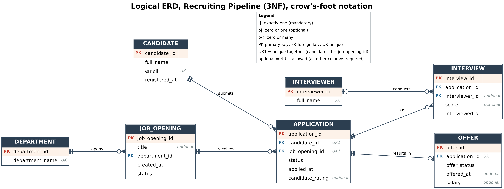
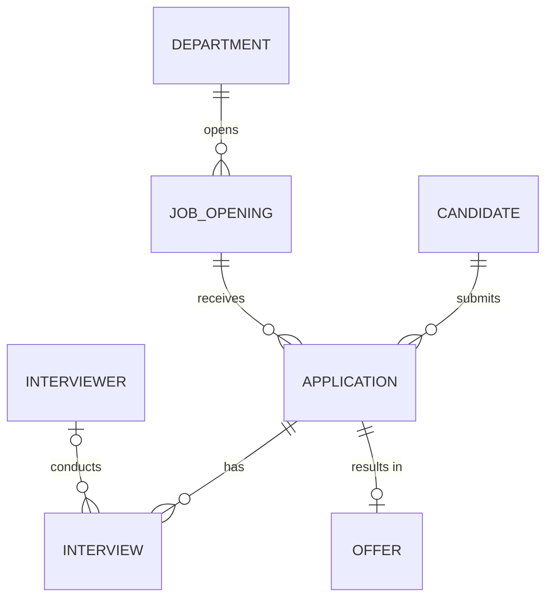

# Logical Data Dictionary

**Dataset:** recruiting-pipeline-v4 → 7 tables in Third Normal Form. **Student:** Bill Frazer Elia (20252SEN030), Group D.
Oracle data types and sizes are left out on purpose; they are added in Phase IV. Key legend: **PK** primary key, **FK** foreign key. "Required" means the column can never be empty (NOT NULL).

## Relationships (crow's-foot notation, as drawn in `erd.png`)

| Parent (one side) | Child (many side) | Foreign key in child | Cardinality | Optionality |
|---|---|---|---|---|
| DEPARTMENT | JOB_OPENING | department_id | 1 : many | child must have a parent; parent may have zero children |
| CANDIDATE | APPLICATION | candidate_id | 1 : many | child must have a parent; parent may have zero children |
| JOB_OPENING | APPLICATION | job_opening_id | 1 : many | child must have a parent; parent may have zero children |
| APPLICATION | INTERVIEW | application_id | 1 : many | child must have a parent; parent may have zero children |
| INTERVIEWER | INTERVIEW | interviewer_id | 1 : many | **parent optional on the child** (an interview may have no recorded interviewer); parent may have zero children |
| APPLICATION | OFFER | application_id | 1 : 0..1 | child must have a parent; an application has at most one offer |

Many-to-many relationships resolved: CANDIDATE ↔ JOB_OPENING through **APPLICATION**; APPLICATION ↔ INTERVIEWER through **INTERVIEW**.

## 1. DEPARTMENT

Lookup of the departments that open vacancies.

| Column | Meaning | Key | Required | Unique | Raw source |
|---|---|---|---|---|---|
| department_id | Identifier of the department | PK | Yes | Yes | generated (Phase IV) |
| department_name | Name of the department: Engineering, HR, Marketing or Sales |  | Yes | Yes | job_openings.department |

## 2. JOB_OPENING

One vacancy opened by a department.

| Column | Meaning | Key | Required | Unique | Raw source |
|---|---|---|---|---|---|
| job_opening_id | Identifier of the opening | PK | Yes | Yes | job_openings.id |
| title | Job title of the vacancy (blank in {S["title_blank"]} raw rows) |  | No | No | job_openings.title |
| department_id | Department that opened the vacancy | FK → DEPARTMENT | Yes | No | job_openings.department |
| created_at | Date and time the opening was created |  | Yes | No | job_openings.created_at |
| status | Whether the opening is Open or Closed |  | Yes | No | job_openings.status |

## 3. CANDIDATE

One person who entered the recruiting system.

| Column | Meaning | Key | Required | Unique | Raw source |
|---|---|---|---|---|---|
| candidate_id | Identifier of the candidate | PK | Yes | Yes | candidates.id |
| full_name | Candidate's full name (anonymised or fictitious) |  | Yes | No | candidates.full_name |
| email | Candidate's email address, stored in lower case |  | Yes | Yes (after merging the 3 duplicate people) | candidates.email |
| registered_at | Date and time the candidate entered the system |  | Yes | No | candidates.applied_at |

## 4. APPLICATION (junction table)

One candidate applying to one job opening. It resolves the many-to-many between CANDIDATE and JOB_OPENING.

| Column | Meaning | Key | Required | Unique | Raw source |
|---|---|---|---|---|---|
| application_id | Identifier of the application | PK | Yes | Yes | applications.id |
| candidate_id | Candidate who applied | FK → CANDIDATE | Yes | Unique together with job_opening_id | applications.candidate_id |
| job_opening_id | Opening applied for | FK → JOB_OPENING | Yes | Unique together with candidate_id | applications.job_opening_id |
| status | Stage of the application: Applied, Interviewing, Offer or Rejected |  | Yes | No | applications.status |
| applied_at | Date and time the application was submitted |  | Yes | No | applications.applied_at |
| candidate_rating | Rating given to the candidate for this application, 1 to 5 (blank in {S["rating_blank"]} raw rows) |  | No | No | applications.candidate_rating |

Dropped from the raw file: `application_date` (conflicting duplicate of `applied_at`) and `interview_count` (derived from INTERVIEW).

## 5. INTERVIEWER

A person who conducts interviews. The raw data has only a name, so a name is treated as one person.

| Column | Meaning | Key | Required | Unique | Raw source |
|---|---|---|---|---|---|
| interviewer_id | Identifier of the interviewer | PK | Yes | Yes | generated (Phase IV) |
| full_name | Interviewer's full name (anonymised or fictitious) |  | Yes | Yes | interviews.interviewer |

## 6. INTERVIEW (junction table)

One interview of one application. It is the child table of the interview list and resolves the many-to-many between APPLICATION and INTERVIEWER.

| Column | Meaning | Key | Required | Unique | Raw source |
|---|---|---|---|---|---|
| interview_id | Identifier of the interview | PK | Yes | Yes | interviews.id |
| application_id | Application being interviewed | FK → APPLICATION | Yes | No | interviews.application_id |
| interviewer_id | Interviewer who ran it; empty when not recorded (blank in {S["intv_blank"]} raw rows) | FK → INTERVIEWER | No | No | interviews.interviewer |
| score | Interview score, 1 to 10 (blank in {S["score_blank"]} raw rows) |  | No | No | interviews.score |
| interviewed_at | Date and time of the interview |  | Yes | No | interviews.interviewed_at |

## 7. OFFER

A job offer made on an application; at most one per application.

| Column | Meaning | Key | Required | Unique | Raw source |
|---|---|---|---|---|---|
| offer_id | Identifier of the offer | PK | Yes | Yes | offers.id |
| application_id | Application the offer belongs to | FK → APPLICATION | Yes | Yes (one offer per application) | offers.application_id |
| offer_status | Outcome of the offer: Accepted or Declined |  | Yes | No | offers.offer_status |
| offered_at | Date and time the offer was made (blank in {S["off_dt_blank"]} raw rows, all Declined) |  | No | No | offers.offered_at |
| salary | Salary offered; the source gives no currency or period (blank in {S["sal_blank"]} raw rows) |  | No | No | offers.salary |

## 8. Business rules to enforce in Phase IV

1. A candidate applies to a given opening at most once (unique candidate_id + job_opening_id).
2. An application has at most one offer (unique application_id in OFFER).
3. Application status is one of Applied, Interviewing, Offer, Rejected; job status is Open or Closed; offer status is Accepted or Declined.
4. `candidate_rating` is between 1 and 5; `score` is between 1 and 10.
5. The number of interviews of an application is computed from INTERVIEW, never stored.

## 9. Editable ERD source (Mermaid, relationships only)

